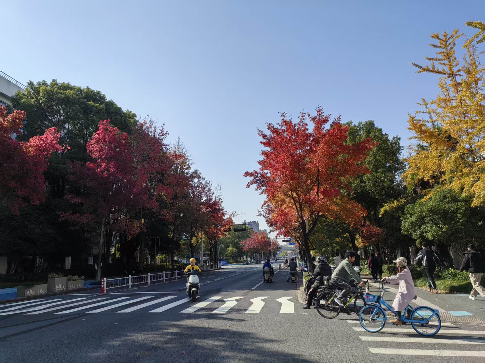

现在是下午一点十分，记于6教被120。

过会儿还要去学院里办事，先随便找个地方坐一会儿。

这是在杭电的第五个秋天。

本部的生活还是很让人怀念的，到了秋天，生活区和教学区的马路两旁的树很漂亮。

南二门口的红枫夹着银杏（应该是？）还有常绿。层次感很不错。

黑夜渐长。哪怕是正午的日光洒下来，也难免有萧瑟的气息。

最近事情繁多，很久没有去仔细地欣赏风景了。

以上。

农历十月十一

秋风过处，霜叶流丹

红叶黄花秋意晚，千里念行客
